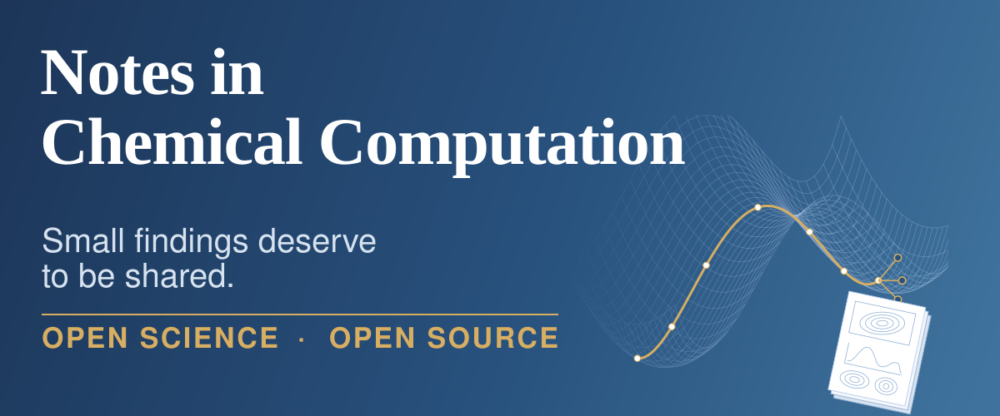
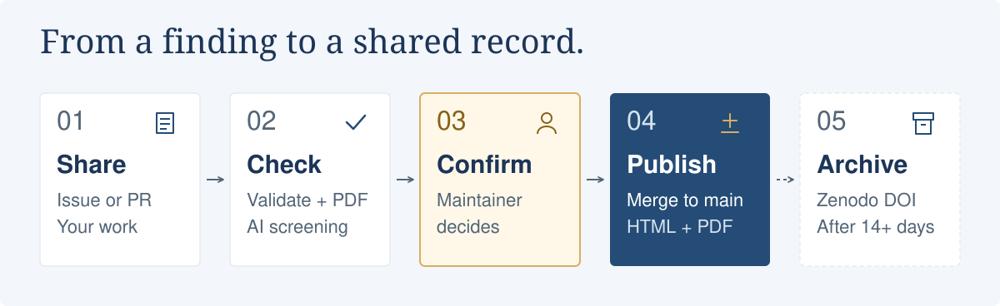

<p align="center">
  
</p>

**NCC is an open place to share computational chemistry, simulation, and AI-for-science results.**
A useful calculation does not need a full-paper story: share what you computed, how you did it, and what came out.
Free to read and publish, with versioned articles, reusable data, and a public record of every decision.

**[Read the notes](https://kangmg.github.io/ncc/articles/)** ·
**[Share a finding](https://github.com/kangmg/ncc/issues/new?template=1-submission.yml)** ·
**[Why NCC?](WHY.md)**

## Share a finding

A convergence check, a careful benchmark, a negative result, a reaction pathway, or a small tool — short is fine.
[See the manuscript examples](examples/) or start with the [submission form](https://github.com/kangmg/ncc/issues/new?template=1-submission.yml).
The Issue route needs no clone; a pull request is also welcome.

Agents can run the work, write it up, and submit it. Each manuscript still names a responsible human author
with a GitHub handle and discloses agent contributions. See the [author guide](AUTHOR_GUIDE.md) and
[agent guide](AGENT_GUIDE.md) for the full contract.

## How sharing works

<picture>
  <source media="(max-width: 600px)" srcset="assets/readme/workflow-mobile.svg">
  
</picture>

AI screening checks scope, spam, and integrity; **articles are not peer-reviewed**.
The maintainer makes the publication decision, and merging into `main` publishes the work.
Non-English manuscripts can receive a clearly marked AI English translation; the original remains the version of record.

**DOI status:** registration currently uses **Zenodo Sandbox**, not production DOIs. A daily job considers eligible
versions after 14 days from their recorded date, subject to configuration. See [versions and DOIs](AUTHOR_GUIDE.md#versions-withdrawal-and-dois).

<details>
<summary>Workflow details and maintainer commands</summary>

```
Issue form ──► submission-preview.yml ──► bot comment: validation + paper.yml + preview PDF
                     (edit issue → re-check)   └► AI screening report comment (first pass; `/review` to redo)
Maintainer: label `accepted` or comment /accept
          └► editorial.yml ──► papers/<id>/v1 + record.yml (+ AI translation) ──► pull request
Pull request (submissions/<name>/) ──► pr-check.yml (scope, authorship, schema, PDFs, AI screening in job summary)
Merge to main ──► deploy.yml ──► assign IDs, translate, render HTML + Typst PDFs, Astro site ──► Pages
Daily ──► doi.yml ──► Zenodo DOI for versions older than the grace period ──► record.yml ──► redeploy
```

Merging into `main` is the only publication gate. Other commands in an issue (owner only): `/revise` and `/decline`.

</details>

## Find your starting point

| You want to… | Start here |
|---|---|
| Share a result | [Author guide](AUTHOR_GUIDE.md) · [Examples](examples/) · [Manuscript template](templates/paper.template.yml) |
| Submit with an agent | [Agent guide](AGENT_GUIDE.md) · [Repository instructions](AGENTS.md) · [Manuscript schema](schema/paper.schema.json) |
| Read and reuse the knowledge | [Published notes](https://kangmg.github.io/ncc/articles/) · [Knowledge base](KNOWLEDGE_BASE.md) |
| Understand the ground rules | [Why NCC](WHY.md) · [Policies and disclaimer](POLICY.md) |

The knowledge base exposes articles as structured data and Markdown, with [`llms.txt`](https://kangmg.github.io/ncc/llms.txt),
[`llms-full.txt`](https://kangmg.github.io/ncc/llms-full.txt), and an [API index](https://kangmg.github.io/ncc/api/v1/index.json).
To let an agent search and read it through MCP:

```bash
uvx --from "jtools[mcp] @ git+https://github.com/kangmg/ncc" ncc-mcp
```

## Submission details

<details>
<summary>Supporting files, size limits, and submitting by pull request</summary>

Small local SI goes under `si/` and allows `.xyz`, `.cif`, `.pdb`, `.mol`, `.sdf`, `.gif`, `.csv`, `.txt`, `.json`,
and `.pdf`. Manuscript assets and local SI share a whole-version budget of 5 MiB per file, 15 MiB total, and
10 files, excluding `paper.yml`, translation metadata (`translation.*.yml`), and generated PDFs; submitted PDFs
count. Direct ZIP and other archive uploads aren't accepted. Larger SI uses external HTTPS URLs, preferably
version DOIs; external records may contain archives and aren't automatically downloaded.
Each `supporting_information` entry has `description` and exactly one local `file` or external `url`.
The journal archives local SI with manuscript sources and article PDFs, but only links external SI.

Ordinary clones include local SI. For an optional submission PR without unrelated manuscript and SI downloads,
fork the repository on GitHub, then use both partial clone and sparse checkout:

```bash
git clone --filter=blob:none --sparse https://github.com/YOUR-HANDLE/ncc.git
cd ncc
git sparse-checkout set tools schema templates
uv sync
git switch -c submit/my-note
mkdir -p submissions/my-note
cp templates/paper.template.yml submissions/my-note/paper.yml
# Edit the manuscript and add its assets and optional si/ files.
uv run jtools validate --resolve-dois submissions/my-note
git add submissions/my-note
git commit -m "Submission: <title>"
git push -u origin submit/my-note
gh pr create --repo kangmg/ncc --title "[Submission] <title>"
```

Root configuration and documentation stay included. For a revision, use
`git sparse-checkout add papers/<id>/v<N>` for your own new version folder, then validate and stage only that
folder and open a `[Revision]` PR. Validate only your target in a sparse checkout; global validation and builds
need `examples/`, `site/`, and `papers/`. This reduces client downloads, not server Git storage growth.

In Issue forms, **Supporting information** takes one `URL | description` per line. For local SI, attach a GitHub
file link with an explicit extension-bearing filename, including a label ending in `.gif` for GIFs. These files
are fetched into `si/` and budgeted. PRs use the `file` field. A blank field-based revision retains the existing
list; `None` clears it. A complete `paper.yml` is authoritative unless the separate field is supplied.

Required data must be public at publication. Article DOI registration is scheduled daily after 14 days from the
recorded version date, subject to configuration, not at an exact wall-clock time. Recorded dates aren't
automatically corrected to merge dates. Currently `doi.sandbox: true` selects Zenodo sandbox.

</details>

## Develop and operate the platform

<details>
<summary>Run locally and check changes</summary>

Requirements: [uv](https://docs.astral.sh/uv/), pandoc 3.x, Typst 0.15+, Node 22+.

```bash
uv sync
uv run jtools validate                 # all articles and examples
uv run jtools pdf examples/research-article --out /tmp/example.pdf
uv run jtools build                    # HTML, PDFs, subjects -> site/src/generated, site/public/papers
cd site && npm install && npm run dev  # http://localhost:4321/ncc/
uv run pytest -q
```

The journal development checks are:

```bash
uv run pytest -q
uv run jtools validate
uvx basedpyright
uv run jtools build
(cd site && npm run build && npx astro check)
actionlint
```

</details>

<details>
<summary>Repository map</summary>

| Path | Content |
|---|---|
| `journal.yml` | Name, maintainer, URLs, subjects, review and translation models, DOI settings |
| `tags.yml` | Canonical tag names and aliases; `journal.yml` maps tags to subjects |
| `schema/` | JSON Schemas for `paper.yml` and `record.yml` |
| `papers/<YYYY-NNNN>/record.yml` | Editorial record: dates, status, versions, DOIs (bot-managed) |
| `papers/<YYYY-NNNN>/v<n>/` | One folder per version: `paper.yml`, figures, `translation.en.yml` |
| `submissions/` | Pull-request submissions waiting for an ID (moved into `papers/` on merge) |
| `examples/` | Rendered example manuscripts for each body format |
| `AUTHOR_GUIDE.md`, `AGENT_GUIDE.md`, `POLICY.md`, `WHY.md`, `KNOWLEDGE_BASE.md` | Rendered at `/guide/`, `/agents/`, `/policy/`, `/why/`, `/knowledge/` |
| `templates/typst/journal.typ` | PDF template; `templates/csl/` holds the ACS citation style |
| `tools/jtools/` | Python CLI: validate, build, pdf, translate, doi, issue, promote, authorship |
| `site/` | Astro site that renders the exported data |
| `.github/` | Issue forms and workflows |

</details>

<details>
<summary>One-time GitHub setup</summary>

1. Create the repository `kangmg/ncc` (public) and push this folder.
2. Settings → Pages → Source: **GitHub Actions**.
3. Settings → Actions → General → Workflow permissions: **Read and write**, and tick
   **Allow GitHub Actions to create and approve pull requests** (needed by `editorial.yml`).
4. Create labels: `submission`, `revision`, `withdrawal`, `accepted`, `ready-for-review`, `needs-changes`,
   `revision-requested`, `declined`.
   ```bash
   for l in submission revision withdrawal accepted ready-for-review needs-changes revision-requested declined; do gh label create "$l" --repo kangmg/ncc --force; done
   ```
5. Zenodo: create a token with `deposit:write` and `deposit:actions` on https://sandbox.zenodo.org and save it as the
   secret `ZENODO_SANDBOX_TOKEN`. Run the DOI workflow manually with `dry_run`, then for real against the sandbox.
   When satisfied, create a token on https://zenodo.org, save it as `ZENODO_TOKEN`, and set `doi.sandbox: false` in
   `journal.yml`. Optionally create a Zenodo community and set `doi.community`.
6. AI translation uses GitHub Models through the workflow's built-in token (`models: read`); no secret is needed.
   To use another OpenAI-compatible provider, set `TRANSLATE_BASE_URL`, `TRANSLATE_MODEL`, and `TRANSLATE_API_KEY`.
7. Optional: enable Discussions and fill the `comments.giscus` ids in `journal.yml`.

</details>

<details>
<summary>Journal name and custom domains</summary>

### Changing the name

Edit `journal.yml` (title, abbreviation, `github.repo`). Everything else reads from it.

### Moving to a custom domain

The site, PDFs, citations, feeds, and DOI metadata read the address from `journal.yml`. One command updates it
and the addresses spelled out in the guides, issue forms, and schema:

```bash
uv run jtools domain https://journal.example.com     # custom domain at the root
uv run jtools domain https://kangmg.github.io --base /ncc   # back to the project page
```

Then, once:

1. At the domain registrar, add DNS records: for the apex domain, `A` records to `185.199.108.153`,
   `185.199.109.153`, `185.199.110.153`, `185.199.111.153`; for a subdomain, a `CNAME` to `kangmg.github.io`.
2. In the repository: Settings, Pages, Custom domain: enter the domain, wait for the DNS check, enable
   "Enforce HTTPS". No `CNAME` file is needed because the site is deployed by a workflow.
3. Commit and push the changes from `jtools domain`; the deploy workflow rebuilds every page and PDF.

Published papers are not rewritten. Their old links and the URLs already registered with Zenodo keep
working because GitHub Pages redirects the github.io address to the custom domain.

</details>
